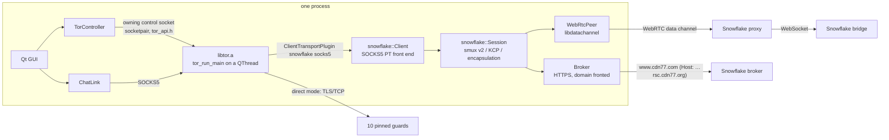

# Tor Qt Prototype

A Qt Widgets app (C++, qmake) that **contains its own Tor node** and chats
with a peer over **onion services**. Nothing has to be installed on the
device: tor, OpenSSL, libevent, zlib, a WebRTC stack and a C++ **Snowflake**
client are all compiled into the one app, for **native Linux**,
**Android (arm64-v8a)** and the **browser** (Qt for WebAssembly with threads;
the target is iPhone Safari, with no server of our own).

It uses the same message format and port (9999) as
[`prototype-arti`](../prototype-arti/), so the two programs should be able to
talk to each other. That interop has not been tested.

## What it does

- **Start Tor**, choosing how to reach the network:
  - **Direct: 10 pinned guards.** Tor connects straight to the first 10 guards
    of [maycon/tor-nodes-list `guard-nodes.json`](https://github.com/maycon/tor-nodes-list/blob/main/guard-nodes.json)
    (`EntryNodes`).
  - **Snowflake (WebRTC proxies).** Tor connects through Tor Browser's
    default Snowflake bridges, via volunteer WebRTC proxies. The 10 guards
    are not used in this mode; the Snowflake bridge is the first hop.
  - In the browser only Snowflake is possible (a page cannot open TCP). If
    two proxies in a row fail, the next attempt is a WebSocket straight to the
    bridge (`wss://snowflake.torproject.net/`), and after that WebRTC again.
- **Start onion service**: publishes a v3 onion service and shows the
  `.onion` address. The first time, tor generates the key
  (`ADD_ONION NEW:ED25519-V3`) and the app saves it to `<profile>/onion-key`
  (mode 0600; in the browser in IndexedDB), so the address stays the same
  after a restart or reload. The key is redacted in the status pane.
  **New address** deletes the saved key and publishes under a fresh one. On
  the temporary data directory (profile in use, see `TOR_QT_PROFILE`) the key
  is throwaway and not saved.
- **Background / foreground**: the status pane logs `App hidden` and `App
  visible again after N s (wall clock), M s (monotonic clock)` (the page's
  `visibilitychange` in the browser, the application state on Android). On
  return, each Snowflake session checks its proxy: it sends a keepalive and
  replaces the proxy if nothing comes back within 5 s, or fetches a proxy
  right away if it was waiting to retry. If the two clocks disagree after
  100 s or more, it notes that tor will rebuild its circuits.
- **Peer**, **Send**, **Received**: send text to `<peer>.onion:9999` through
  tor's SOCKS port. If a peer connects to you first, you can reply without
  entering an address.
- **Status / debug**: tor's log (as control-port events), control commands,
  bootstrap progress, descriptor uploads, every Snowflake step (ICE, broker,
  proxy, KCP/smux) and libdatachannel warnings. The same lines go to stderr on
  Linux, to logcat on Android and to the browser console.

## Architecture



| Source | Role |
|---|---|
| `src/torcontroller.*` | Writes the torrc, starts tor in-process (`tor_run_main`) and drives it over the pre-authenticated owning control socket. Closing that socket makes tor exit. |
| `src/snowflake/client.*` | SOCKS5 listener that tor uses as an external pluggable transport. Parses the bridge-line arguments that tor sends in the SOCKS username/password fields. |
| `src/snowflake/session.*` | One tor connection to one Snowflake session: smux v2 (stream 3, window updates, keepalive) over KCP (stream mode, `nodelay 0,0,0,1`, window 65535) over turbotunnel. When a proxy disappears, it fetches a new one and resends the token + client ID so the server re-attaches the same KCP session. |
| `src/snowflake/encapsulation.*` | Snowflake's length-prefix/padding framing for KCP packets. |
| `src/snowflake/peer.h` | What a `Session` sends through: a WebRTC proxy or (browser) a WebSocket to the bridge. |
| `src/snowflake/webrtcpeer.*` | Offer with one ordered data channel, waits for full ICE gathering, strips private host candidates, applies the answer. |
| `src/snowflake/websocketpeer.*` | Browser only: WebSocket straight to the bridge, the fallback when no proxy connects. |
| `src/snowflake/broker.*` | `POST /client` with `1.0\n{offer,nat,fingerprint}`, domain-fronted through CDN77 (directly in the browser). |
| `src/third_party/kcp/` | Vendored [KCP 2.1.1](https://github.com/skywind3000/kcp) (MIT). |
| `src/chatlink.*` | The chat: one TCP stream, u32 little-endian length + UTF-8. |
| `src/appvisibility.*` | Background/foreground events (browser `visibilitychange`, Qt application state) with the time spent away. |
| `src/loopback.h` | Socket types for the app↔tor loopback connections: Qt's sockets natively, `ShimSocket`/`ShimServer` in the browser. |
| `src/wasm/netshim.*` | Browser only: libc socket/fd/`poll` calls as in-memory loopback pipes inside the tab. |
| `src/wasm/shimsocket.*` | Browser only: the `QTcpSocket`/`QTcpServer`/`QLocalSocket` subset the app uses, on netshim fds, including SOCKS5 for dialling onions. |
| `web/` | Browser only: the page (`index.html`), a COOP/COEP service worker, the web app manifest and icon. |

The Snowflake protocol was implemented from the Go client source
(`gitlab.torproject.org/tpo/anti-censorship/pluggable-transports/snowflake`,
commit `3fa5bc8b`, 2026-10-08), with smux v1.5.57 and kcp-go v5.6.72.

Not implemented in the C++ Snowflake client:
- AMP cache and SQS rendezvous (only `url=` + `fronts=`).
- uTLS fingerprint mimicry for the broker request (Qt's TLS is used).
- NAT type detection (it reports `unrestricted` first and `unknown` after a
  failed proxy, like the Go client's NAT policy).
- covert-DTLS.

## Build

All three targets in one go:

```bash
./build.sh                  # linux + android + wasm  (~1.5 min once deps exist)
./build.sh linux wasm       # only these
./build.sh --clean android  # wipe that target's build tree first
```

| Target | Output | Size |
|---|---|---|
| Linux | `dist/prototype-tor-qt` | 13 MB, x86_64 |
| Android | `dist/prototype-tor-qt-debug.apk` | 23 MB, arm64-v8a, debug-signed |
| Browser | `dist/web/` (serve this folder) | 19 MB |

`build.sh` runs `deps/build-deps.sh <target>` first when `deps/install/<target>`
is missing. Build trees and Gradle's cache go to `$BUILD_DIR` (default
`/shared/tmp/prototype-tor-qt-build`). The toolchain paths default to the Qt
image (`/opt/Qt/6.8.3/…`, `/opt/emsdk`, `/opt/android-sdk`); `./build.sh --help`
lists the variables that override them. The steps it runs are below.

### 1. Native dependencies (once per target)

```bash
deps/build-deps.sh linux      # -> deps/install/linux    (~2 min)
deps/build-deps.sh android    # -> deps/install/android  (arm64-v8a, API 28)
deps/build-deps.sh wasm       # -> deps/install/wasm     (Emscripten + pthreads, ~3 min)
```

Pinned versions, checked against sha256: tor 0.4.9.14 (built as `libtor.a`,
client-only), OpenSSL 3.5.9, libevent 2.1.12, zlib 1.3.2, libdatachannel
v0.24.6 (git tag). Sources and build trees go to `$WORK_DIR` (default
`/shared/tmp/prototype-tor-qt-deps`). `deps/install/` is git-ignored.

On Android, OpenSSL is built **shared** as `libssl_3.so` / `libcrypto_3.so`
(see `deps/openssl-android-qt.conf`). Qt's TLS backend loads those exact
names, and tor and libdatachannel link the same copies. On Linux everything is
static. Qt itself uses the system OpenSSL there.

For `wasm`, everything is built with `emcc -pthread`. OpenSSL has no
assembler, DSO or secure heap. libevent ends up with only its `poll`/`select`
backends. Instead of libdatachannel it builds
[datachannel-wasm](https://github.com/paullouisageneau/datachannel-wasm)
v0.4.0: the same `rtc::` API on top of the browser's `RTCPeerConnection`, plus
`rtc::WebSocket`. Its JS libraries go to `deps/install/wasm/lib/js/`.

Needs: a C/C++ toolchain, autotools, perl, cmake, git, curl; the Android NDK
for `android` (default: newest under `$ANDROID_SDK_ROOT/ndk`); emsdk for
`wasm` (`$EMSDK`, default `/opt/emsdk`; Qt 6.8 needs Emscripten 3.1.56).

### 2. The app

```bash
# Linux
mkdir -p /shared/tmp/tor-qt-linux && cd /shared/tmp/tor-qt-linux
/opt/Qt/6.8.3/gcc_64/bin/qmake /path/to/prototype-tor-qt/prototype-tor-qt.pro
make -j
./prototype-tor-qt

# Android APK (debug-signed)
export ANDROID_SDK_ROOT=/opt/android-sdk ANDROID_NDK_ROOT=/opt/android-sdk/ndk/26.1.10909125
mkdir -p /shared/tmp/tor-qt-android && cd /shared/tmp/tor-qt-android
/opt/Qt/6.8.3/android_arm64_v8a/bin/qmake /path/to/prototype-tor-qt/prototype-tor-qt.pro CONFIG+=debug
make -j && make apk
adb install -r android-build/prototype-tor-qt.apk

# Browser (Qt for WebAssembly with threads)
source /opt/emsdk/emsdk_env.sh
mkdir -p /shared/tmp/tor-qt-wasm && cd /shared/tmp/tor-qt-wasm
/opt/Qt/6.8.3/wasm_multithread/bin/qmake /path/to/prototype-tor-qt/prototype-tor-qt.pro
make -j
python3 -m http.server 8080      # then open http://localhost:8080/index.html
```

If Gradle fails with `?/.android/debug.keystore which doesn't exist`, Java
cannot find a home directory for your user; `export
JAVA_TOOL_OPTIONS=-Duser.home=$HOME` before `make apk` (`build.sh` does this).

The browser build needs the **threaded** Qt for WebAssembly
(`wasm_multithread`, Emscripten 3.1.56); `qmake` refuses the single-threaded
one. Open **`index.html`**, not the generated `prototype-tor-qt.html`:
`index.html` mounts IndexedDB at `/persist` (tor's data directory) and turns
URL query parameters into environment variables.

To host it, copy `index.html`, `coi-serviceworker.js`, `manifest.webmanifest`,
`icon.svg`, `qtloader.js`, `prototype-tor-qt.js`, `prototype-tor-qt.wasm` and
`prototype-tor-qt.worker.js` (exactly what `build.sh` puts in `dist/web/`) to
any static **HTTPS** host (or `localhost`).
Threads need a cross-origin isolated page. If the host does not send
`Cross-Origin-Opener-Policy: same-origin` and `Cross-Origin-Embedder-Policy:
require-corp`, `coi-serviceworker.js` adds them and reloads the page once.

The `.pro` file also opens directly in Qt Creator with a Desktop, an
Android arm64-v8a or a WebAssembly (multi-threaded) kit. Use `qmake
DEPS_PREFIX=…` to point it at another dependency tree.

## Environment variables

| Variable | Purpose |
|---|---|
| `TOR_QT_PROFILE` | Data directory name (`<AppLocalData>/tor-<profile>`), default `default`. If another instance already runs tor on that profile, tor would wait 5 s and exit, so the app falls back to a temporary data directory (`<temp>/prototype-tor-qt-XXXXXX`, seeded with the profile's `cached-*` directory files, removed on exit; leftovers from killed instances are removed on the next start). Use different profiles to give each instance its own persistent state. |
| `TOR_QT_AUTOSTART` | `direct` or `snowflake`: press *Start Tor* automatically, and start the onion service once bootstrap reaches 100 %. Useful for headless runs (`QT_QPA_PLATFORM=offscreen`). The browser always uses `snowflake`. |
| `TOR_QT_AUTOSEND` | A peer's onion address: once our own onion service is published, send it one `hello from <our onion>` message. For end-to-end tests. |
| `SNOWFLAKE_TRACE` | Log every smux frame. |

In the browser, pass these as URL query parameters, e.g.
`index.html?TOR_QT_AUTOSTART=snowflake&TOR_QT_PROFILE=b`.

## Status (2026-10-12)

Tested on Linux (in the dev container, against the live Tor network):

- **Direct mode:** embedded tor bootstrapped through the 10 pinned guards
  within about a minute, created the onion service and uploaded its
  descriptor. A test client then connected through the app's own SOCKS port to
  `<onion>:9999`, and the message showed up as received.
- **Snowflake mode:** the C++ client went from domain-fronted broker
  rendezvous through CDN77, to a WebRTC proxy, KCP/smux, and the Snowflake
  bridge. Tor bootstrapped to 100 % over it, the onion service was
  published, and a test client reached `<onion>:9999` through it (11 s to
  connect).
  - About 1 in 4 proxy attempts open a data channel in this container's
    network. The rest time out and are retried every 10 s, so the first
    connection can take a few minutes.
  - Bootstrapping over a proxy is noticeably slower than direct.

Android: `make apk` builds a debug-signed `arm64-v8a` APK (~26 MB, minSdk 28)
that contains `libtor`, libdatachannel and `libssl_3.so`/`libcrypto_3.so`.
**It has not been run on a phone yet.**

### Browser (2026-10-17)

Tested in headless Chromium in the dev container, against the live network,
with the Linux build as the peer:

- The page is served by a plain static server **without** COOP/COEP headers.
  The service worker made it cross-origin isolated, and threads work.
- Tor ran on a pthread, with its control socket, SOCKS port and the Snowflake PT
  port all going through netshim. The broker was reached with `fetch()`
  (no domain fronting), WebRTC proxies connected, and tor bootstrapped to 100 %.
  The onion service was published.
- **Linux → browser**: the Linux app (direct mode) dialled the browser's onion
  address, and the message showed up as received in the page.
- **Browser → Linux**: the page dialled the Linux app's onion address through
  `ShimSocket`'s SOCKS5 and the message arrived. One of two attempts failed with
  tor's SOCKS reply "TTL expired" (the onion connection timed out); the retry
  connected straight away.
- **IndexedDB**: after a reload, tor reused its cached consensus, and bootstrap
  went from 15 % straight to 75 %.
- **WebSocket fallback**: with UDP blocked
  (`--force-webrtc-ip-handling-policy=disable_non_proxied_udp`) and an empty
  profile, two proxy attempts failed. The session then connected straight to
  `wss://snowflake.torproject.net/`, tor bootstrapped to 100 % and published its
  onion service.

Also tested in headless Firefox ESR 153 (2026-10-17): Snowflake bootstrap,
browser → Linux and Linux → browser chat all worked.

Not tested: **Safari / iPhone**. Memory is capped at 256 MB
(`QT_WASM_MAXIMUM_MEMORY`) for iOS but has not been measured on a phone.

## Limitations

- tor can only be started **once per process** (a tor_api limitation). Restart
  the app to switch modes. In the browser, reload the page.
- tor's own messages reach the status pane only once the control connection
  is up; anything earlier (e.g. a broken torrc) is printed to stderr only. If
  tor exits, the status pane shows `ERROR: tor stopped on its own (exit code
  N)`, and the reason is in the `[err]` lines on stderr (Qt Creator:
  *Application Output*).
- Android: the onion service is only reachable while the app is in the
  foreground. There is no foreground service yet.
- Pinning 10 guards from a third-party list makes you stand out (tor warns:
  "excludes 99% of all possible guards") and fails if all 10 are offline.
- Browser: the onion service is reachable only while the tab is open and in
  the foreground. iOS suspends hidden tabs (and home-screen PWAs) within
  seconds, and circuits drop.
- Browser: Snowflake only. When the broker has no proxy, CDN77 answers with an
  error page that has no CORS headers, so the page sees only "no readable
  response" and retries.
- Browser: **ad-blockers can break Snowflake.** uBlock Origin in Firefox
  blocked the broker and the bridge. The console then shows
  `Cross-Origin Request Blocked … (Reason: CORS request did not succeed).
  Status code: (null)` for `https://1098762253.rsc.cdn77.org/client`, and the
  WebSocket fallback fails with "can't establish a connection to the server at
  wss://snowflake.torproject.net/". Despite the wording, this is not a CORS
  problem: the request never got out. Disable the blocker for the page, or
  allow `*.torproject.net` and `*.rsc.cdn77.org`.
- Browser: Safari may evict IndexedDB after about 7 days without a visit. The
  consensus is then downloaded again.

## WebAssembly

Goal: the whole app as one web page on an iPhone, with no server of our own.
The plan, decisions and iOS limits are in
[`plans/prototype-tor-qt.md`](../../../plans/prototype-tor-qt.md) (Phase 3).
In short, a browser cannot open TCP, so the browser build is **Snowflake-only**
and the 10 pinned guards cannot be used. It tries WebRTC first and falls back
to a direct WebSocket to the Snowflake bridge.

All local sockets (the control socketpair, tor's SOCKS port, the PT port and the
onion target) are kept inside the tab by **`src/wasm/netshim.c`**. It replaces
libc's socket, pipe, fd and `poll`/`select` calls with in-memory loopback
pipes, and `connect()` to anything other than 127.0.0.0/8 fails with
`ENETUNREACH`.

Qt's socket notifiers cannot see netshim fds, so on the Qt side
**`src/wasm/shimsocket.*`** provides `ShimSocket` / `ShimServer` with the same
API subset as `QTcpSocket` / `QTcpServer` / `QLocalSocket` (`src/loopback.h`
picks the type). netshim's readiness callback fires on tor's thread and
posts a single wake-up to the Qt thread. That thread then services every shim
socket without blocking.

```bash
deps/build-deps.sh wasm
tests/wasm/run-tests.sh     # netshim unit test + tor spike, under Node
```

`tests/wasm/tor_spike.c` runs the real `libtor.a` on a pthread on top of
netshim. Its control port, SOCKS5 port and the connection to the Snowflake PT
port all pass under Node and in headless Chromium (2026-10-17).

The browser-specific settings in `prototype-tor-qt.pro` are: a pool of 8
pthreads, 1 MB pthread stacks, 96 MB initial / 256 MB maximum memory (override
with `qmake QT_WASM_MAXIMUM_MEMORY=…`), `-fexceptions`, and datachannel-wasm's
JS libraries. In the torrc, `NumCPUs 1` keeps tor to one cpuworker.
