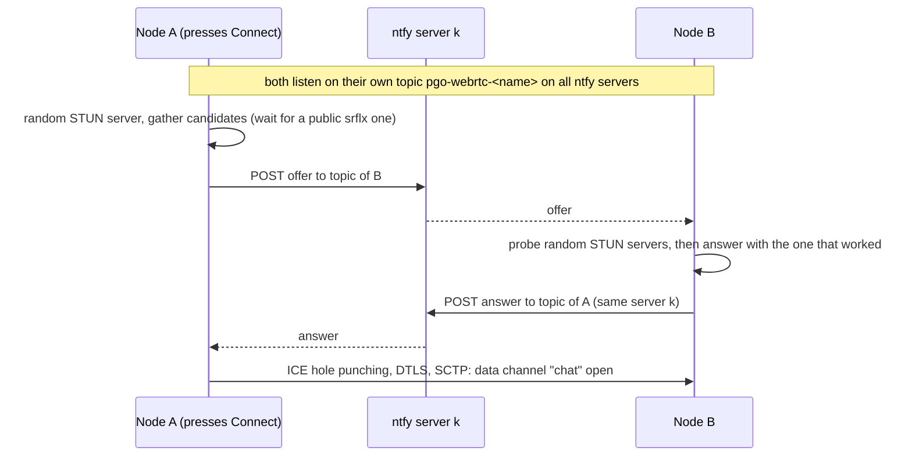

# WebRTC STUN Prototype

A Qt Widgets app (C++, qmake) where two nodes chat over a **direct WebRTC data
channel**. A node is addressed by a **node name** such as `brave-otter-417`.
The WebRTC offer and answer are exchanged through **public ntfy servers**.
NAT traversal uses **STUN only**, with no TURN: each attempt picks a random
server from [mondain's STUN list](https://gist.github.com/mondain/b0ec1cf5f60ae726202e).
Once the channel is open, chat messages go peer to peer and ntfy is no longer
involved.

Targets: **native Linux**, **Android (arm64-v8a)** and the **browser** (Qt for
WebAssembly, single-threaded). All three can talk to each other.

Plan and design decisions: [`plans/prototype-webrtc-stun.md`](../../../plans/prototype-webrtc-stun.md).

## What it does

| Widget | Behaviour |
|---|---|
| **Node name** + **Generate** | Your node's name. One is generated and saved on first start. **Generate** makes a new one, and the node is then reachable under the new name only. |
| **Other node** + **Connect** | Type the other node's name and press **Connect** (or Enter). The button becomes **Disconnect** while a call is set up or running. |
| **Send** | Text to send over the data channel (Enter or **Send**). Enabled while connected. |
| **Received** | Chat lines from the peer, plus your own lines (`me:`). |
| **Status / debug** | Every step, with milliseconds since the call started, shows where the time goes. |
| **WebRTC debug log** (Linux/Android) | Adds libjuice's ICE events to the status pane: candidates, every connectivity check sent to and received from which address, pair success or failure, the selected pair. Applies to connections set up after ticking it; the setting is saved. Warnings and errors from libdatachannel are always shown. |

Only one side presses Connect. **Incoming calls are accepted automatically**
and the caller's name is filled in under "Other node". A new call replaces
the current one.

## How a connection is made



- **ntfy servers** (`resources/ntfy-servers.txt`): every node listens on its
  own topic on **all** of them. A call posts its offer to the **first**
  server. If that attempt fails, the next attempt uses the **next** server,
  and so on, once around the list. An attempt fails when:
  - the POST fails;
  - there is no answer within 15 s;
  - the channel is not open 8 s after the answer.

  A later Connect continues the rotation where it stopped; after a success it
  stays on the server that worked. The answer goes back on the server the
  offer arrived on.
- **STUN** (`resources/stun-servers.txt`, a verbatim copy of the gist): about
  half of the 2015-era list is dead. A server that gives no public
  (server-reflexive) address is replaced by another random one, for up to 8 s
  and 10 servers. Names that no longer resolve fail in milliseconds; silent
  servers take 2 s. Failed servers are skipped for the rest of the session.
  After that the description goes out with host candidates only, which still
  works on the same LAN.
- **Why the answerer probes first:** a peer connection that has seen the
  offer starts ICE checks at once. If the answerer replaced it to try another
  STUN server, the caller's ICE could lock onto the discarded one and DTLS
  would fail. So the answerer finds a working STUN server with a throwaway
  connection first, and then creates exactly one real connection.
- **Who sends the first packet alternates per attempt.** On attempts 1, 3,
  5, … the answerer starts its connectivity checks as soon as it has the
  offer (standard ICE). On attempts 2, 4, … the offer carries `"hold":true`,
  and the answerer holds the caller's candidates until 2 s after posting its
  answer, so the caller's checks go out first. It still answers checks that
  come in during that time. Why: tested 2026-10-18 between a home router
  (KPN, `81.205.x.x`) and a phone on mobile data (port-restricted carrier
  NAT). It only connected when the home side sent first. If the phone's
  packet reached the home router first, the router dropped everything for
  that flow afterwards. Which side must go first depends on the two
  networks, so the order alternates, and such a pair connects on attempt 1
  or 2 (≈ 10–12 s worst case). `WEBRTC_STUN_ANSWER_DELAY_MS` changes the 2 s.
- **Both press Connect at once:** the node with the smaller name keeps its
  offer, and the other answers it.
- **Signaling messages** are JSON in the ntfy message body (< 4 KB, about
  700 bytes in practice), carrying the full SDP with inlined candidates
  (no trickle ICE):

  ```json
  {"v":1,"type":"offer|answer|bye","from":"<name>","sid":"<8 hex>","sdp":"..."}
  ```

## Build

Everything is built with `./build.sh` (the same layout as prototype-tor-qt):

```sh
./build.sh                 # linux + android + wasm
./build.sh linux wasm      # only these
./build.sh --clean android # wipe that target's build tree first
```

The first build of a target runs `deps/build-deps.sh <target>`, which builds:

- natively: OpenSSL 3.5.9 (sha256-pinned) and libdatachannel v0.24.6 (with
  libjuice and usrsctp, no WebSocket or media);
- for the browser: datachannel-wasm v0.4.0 (the browser's RTCPeerConnection
  and WebSocket behind the same `rtc::` API), without threads.

The output goes to `deps/install/<target>/`; sources and build trees go to
`/shared/tmp/prototype-webrtc-stun-deps`.

Deliverables in `dist/`:

| File | Target |
|---|---|
| `dist/prototype-webrtc-stun` | Linux x86_64 executable |
| `dist/prototype-webrtc-stun-debug.apk` | Android arm64-v8a, debug-signed, min SDK 28 |
| `dist/web/` | Browser build: `index.html`, `qtloader.js`, `.js`, `.wasm`, icon. |

`dist/web/` is single-threaded, so it needs **no COOP/COEP headers and no
service worker**. Any static host works, as long as it uses HTTPS or
`localhost`, because WebRTC needs a secure context.

Toolchain variables (defaults match the Qt image): `QT_HOST_LINUX`
(`/opt/Qt/6.8.3/gcc_64`), `QT_ANDROID` (`/opt/Qt/6.8.3/android_arm64_v8a`),
`QT_WASM_DIR` (`/opt/Qt/6.8.3/wasm_singlethread`), `ANDROID_SDK_ROOT`,
`ANDROID_NDK_ROOT`, `EMSDK` (`/opt/emsdk`), `JOBS`, `BUILD_DIR`
(`/shared/tmp/prototype-webrtc-stun-build`).

Platform notes:
- **Linux**: OpenSSL is linked statically for libdatachannel. Qt's own TLS,
  for the ntfy HTTPS, uses the system OpenSSL.
- **Android**: libdatachannel links its own static OpenSSL, with symbols
  hidden. Shared `libssl_3.so`/`libcrypto_3.so` are bundled only for Qt's TLS
  backend (ntfy HTTPS), which loads those names at runtime. The app itself
  must not depend on them: Arch's AUR cross Qt deploys its own OpenSSL under
  the same file names, overwrote ours in the APK, and the app then failed to
  start (`cannot find "libssl_3.so" from verneed[0]`).
  Only the `INTERNET` permission is needed. The keyboard holds the
  word being typed as uncommitted "composing" text, which `QLineEdit` doesn't
  report. So **Send** commits it before reading the field, and the Other node
  field turns predictive text off.
  The deps are built for API 28 (`deps/install/android/android-api`), because
  usrsctp calls `getrandom()`, which older libc stubs lack. If a Qt kit
  defaults to a lower `ANDROID_PLATFORM` (e.g. Arch's AUR cross Qt), the
  `.pro` raises its compile/link target to 28 and says so in a qmake
  message.
- **Browser**: Qt for wasm only delivers an HTTP reply once it is complete,
  so the ntfy subscriptions use WebSockets (`wss://<server>/<topic>/ws`)
  instead of the streaming `/json` endpoint used natively. POSTs go through
  Qt (`fetch()`) as simple CORS requests. The node name is saved in
  `localStorage`.

## Running

- **Linux**: `dist/prototype-webrtc-stun`.
- **Android**: `adb install -r dist/prototype-webrtc-stun-debug.apk`.
- **Browser**: serve `dist/web/` and open `index.html`, for example
  `cd dist/web && python3 -m http.server 8080` and then
  `http://localhost:8080/`.

To try it, start two nodes, type one node's name into the other node and
press Connect.

## Environment variables

For headless tests and for running two instances on one machine. In the
browser, the same names work as URL query parameters, e.g.
`index.html?WEBRTC_STUN_NAME=test-a&WEBRTC_STUN_CONNECT=test-b`.

| Variable | Effect |
|---|---|
| `WEBRTC_STUN_PROFILE` | Separate saved node name per profile (default `default`), so two instances on one machine get different names. |
| `WEBRTC_STUN_NAME` | Use this node name (not saved). |
| `WEBRTC_STUN_CONNECT` | Call this node 3 s after start. |
| `WEBRTC_STUN_AUTOSEND` | Send this text whenever a connection opens. |
| `WEBRTC_STUN_RTCLOG` | Tick **WebRTC debug log** at start (Linux/Android). |
| `WEBRTC_STUN_ANSWER_DELAY_MS` | On attempts where the caller sends first: how long the answerer holds back after posting its answer (default 2000). |
| `WEBRTC_STUN_FIRST` | Use this `host:port` as the first STUN server (e.g. a dead one, to test the retry). |

Headless Linux: `QT_QPA_PLATFORM=offscreen`; the status lines also go to stderr.

## Status (2026-10-18)

Verified in the container against the live ntfy and STUN servers:

| Pair (caller → answerer) | Result |
|---|---|
| Linux → Linux | connected, chat both ways (0.5–7 s, depending on dead STUN picks) |
| Linux → browser (headless Chromium) | connected, chat both ways |
| browser → Linux | connected, chat both ways |
| Unknown node | rotates ntfy.sh → ntfy.adminforge.de → ntfy.envs.net …, 15 s per attempt |
| Dead STUN servers | replaced after 2 s (silent) or within milliseconds (name no longer resolves) |

Most tests ran inside one container, so the peers were on the same host and
connected over host candidates.

**Across two real NATs** (2026-10-18, Linux behind a home router ↔ Android on
mobile data, both native, with the WebRTC debug log): srflx ↔ srflx over
IPv4 works, but only when the home side sends its first check before the
phone's arrives. That's why the order now alternates per attempt (see "How a
connection is made"). The phone had no IPv6 on mobile data (`Network
unreachable` for the IPv6 pairs is expected). Before the alternation:
phone → Linux connected and Linux → phone always failed. With the answerer
holding back on every attempt, it was the reverse. The alternating build
itself has not been run between the two networks yet.

In the browser tests, Chromium ran with
`--disable-features=WebRtcHideLocalIpsWithMdns`. Without it, Chrome hides
host addresses behind `.local` mDNS names that libjuice cannot resolve, so
browser ↔ native on the same LAN would need the srflx path (NAT hairpinning).

In one of 11 Linux → browser runs, the browser's automatic first message did
not appear on the Linux side even though the connection was open. 5 repeats
did not reproduce it.

The Android build runs on a phone (built from Qt Creator with Arch's AUR cross Qt, see the Android notes).

## Limitations

- **No TURN** (by design): if either side is behind a symmetric NAT (common
  on mobile carriers and corporate networks), ICE fails. Each attempt then
  fails after the 15 s open timeout and the next ntfy server is tried, which
  cannot help.
- **Signaling is public:** topic names are guessable from node names, and
  ntfy operators can read the offers. Those contain IP addresses and DTLS
  fingerprints, but no chat content: the data channel is DTLS-encrypted end
  to end. Anyone who knows a node name can call it, because calls are
  auto-accepted.
- No ICE restart on network change (Wi-Fi ↔ mobile): the connection drops,
  and Connect sets up a new one.
- One peer at a time. No message history and no offline queue.
- ntfy.fossman.de rate-limits (HTTP 429) often; its subscription retries with
  backoff up to 60 s. The other servers are unaffected.
- On Android and iOS, the OS suspends the app or tab in the background, and
  the connection drops after about 30 s (ICE consent expires).
