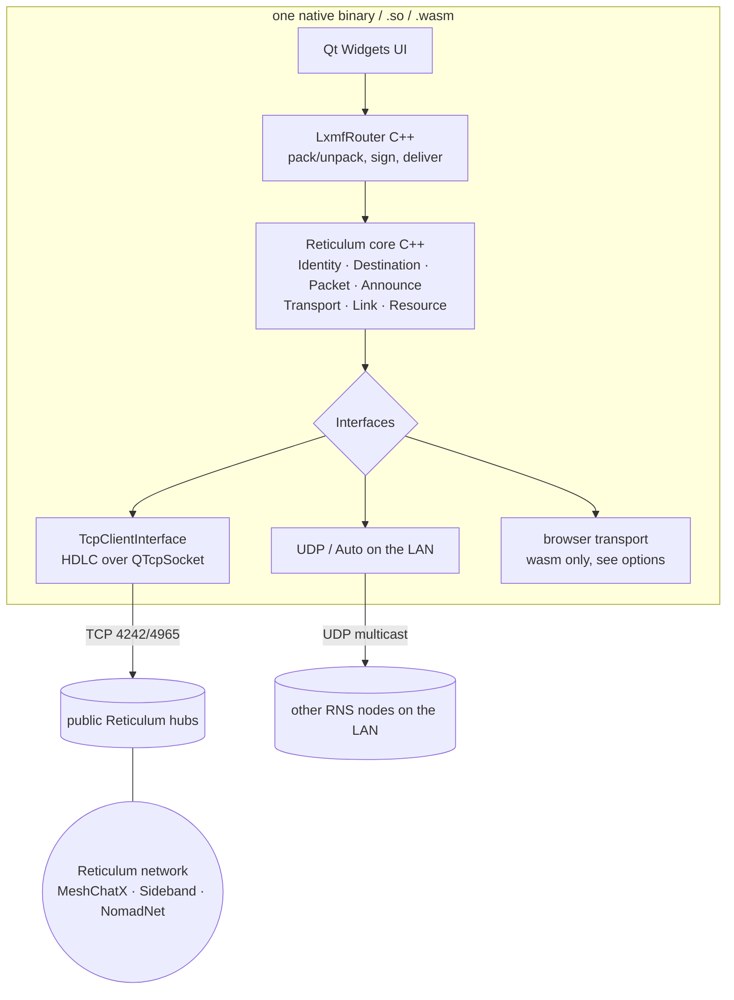

# prototype-reticulum-qt — embedded Reticulum node (Linux, Android, WebAssembly) — Plan (DRAFT)

Status: **draft, open questions below**. Nothing is built yet.

## Goal
Do what `prototype-tor-qt` does, but with [Reticulum](https://reticulum.network)
instead of Tor: one Qt Widgets app (`ai-trash/prototypes/prototype-reticulum-qt`)
that **contains its own Reticulum node**, so it runs on Linux, a stock Android
phone and in a browser with nothing else installed.

Same UI as prototype-tor-qt:
- *Start* (choose the interface: TCP hub / LAN / browser transport)
- *Generate address* → shows our **LXMF address** (16-byte destination hash,
  32 hex characters) instead of an onion address
- peer address, send box, received box, status/debug box

If messages use **LXMF** (the format MeshChat / [MeshChatX](https://meshchatx.com/)
and Sideband use), the prototype can chat with those apps as well as with itself.

## How Reticulum maps onto the tor-qt design

| prototype-tor-qt | prototype-reticulum-qt |
|---|---|
| embedded C tor (`libtor.a`) | embedded Reticulum stack (C++) |
| onion address | LXMF delivery destination hash (`<32 hex>`) |
| ADD_ONION + HS descriptor publish | send an **announce** for our destination |
| SOCKS connect to `<peer>.onion:9999` | path request → **Link** (or single opportunistic packet) to the peer's destination |
| u32 LE length + UTF-8 over a stream | **LXMF message** (msgpack: timestamp, title, content, fields; Ed25519-signed) |
| 10 pinned guards / Snowflake | **interfaces**: TCP client to public hubs, UDP/Auto on the LAN, browser transport (see below) |
| tor data dir | Reticulum storage: identity key, known destinations, path table, ratchets |

## Which Reticulum implementation? (question 1)
There is no C/C++ reference: the reference stack (RNS) and LXMF are Python.

| | Language / license | Fits a Qt C++ app on Linux + Android + wasm? | Notes |
|---|---|---|---|
| **A. [microReticulum](https://github.com/attermann/microReticulum)** (recommended) | C++17, Apache-2.0, CMake | yes, compiles into the app like tor did; deps (rweather/Crypto, ArduinoJson, MsgPack) are portable C++ and build under the NDK and Emscripten | MCU-first port. Identity/Destination/Packet/Announce/Transport/Link/Resource on its roadmap, interop tests against Python RNS exist, **only a UDP interface** ships. We add a TCP (HDLC) interface and LXMF ourselves. Maturity must be verified in step 1. |
| B. [Reticulum-Go](https://reticulum-go.quad4.io/docs/overview?lang=en) via its C ABI `librns` | Go, Reticulum License | Linux yes (`c-shared` + C++17 bindings). Android needs a Go NDK build. **wasm: a Go wasm module cannot be linked into the Emscripten/Qt wasm**; it would be a second wasm module glued through JS | Most complete (Link, Resource, TCP/UDP/Auto/WebSocket marked complete), same team as MeshChatX. New toolchain (Go). |
| C. Embed Python RNS + LXMF | Python | Linux ok; Android via an embedded CPython; browser via Pyodide (~10+ MB extra, no threads, no sockets) | Reference behaviour, but the heaviest and least "C++/Qt". |
| D. Write our own C++ RNS subset | C++ | yes | Only what is needed (Identity, announce, single-packet + Link, LXMF). Several thousand lines of security-sensitive code. |

## Browser: how does a tab reach Reticulum? (question 3)
Same constraint as tor-qt: **a browser cannot open TCP or UDP**, and the
Reticulum network is mostly TCP hubs (port 4242/4965), UDP and radio.

| | How | Server we run? | Notes |
|---|---|---|---|
| **W1. WebSocket hub** | a `WebSocketInterface` in the app → a hub that speaks Reticulum over WebSocket (`reticulum-js` websocket-server, Reticulum-Go WebSocket interface, or rnsd + a WS bridge) | **yes**, unless a public `wss://` hub exists. I found **no maintained list of public wss:// Reticulum hubs** (2026-10-18) | Smallest wasm build. |
| **W2. Reticulum over Tor** | reuse prototype-tor-qt's wasm tor + Snowflake; the TCP interface connects through tor's SOCKS to a Reticulum hub's **.onion** address (RNS supports TCP over Tor/I2P) | no (Tor Project's Snowflake + an existing onion hub) | Keeps "we run no server", but the wasm grows by tor (~19 MB total) and needs a public onion Reticulum hub. |
| W3. Linux + Android first | defer the browser | — | Lowest risk; decide W1/W2 after phase 2. |

## Phases (proposal)
1. **Spike**: build microReticulum natively (CMake → static lib, from `deps/build-deps.sh`
   like tor-qt), check Identity/announce/Link interop against Python `rnsd` in the
   container (Python RNS installed into the image for tests only).
2. **Linux app**: Qt UI (copied from prototype-tor-qt), `TcpClientInterface`
   (HDLC framing, `QTcpSocket`), LXMF router (opportunistic single-packet and
   over a Link), identity persisted in `AppLocalData`. Verify: Linux ↔ Linux
   and Linux ↔ Python LXMF (`lxmd` / MeshChatX) through a public hub.
3. **Android APK**: NDK build of the same deps, same verification on a phone.
4. **WebAssembly**: the chosen browser transport (W1/W2), IndexedDB for the
   identity, same `web/` shell (COOP/COEP service worker, manifest) as tor-qt.

Build system: qmake `.pro` + `build.sh` + `deps/build-deps.sh` (sha256-pinned
tarballs / git tags), same layout as prototype-tor-qt. `dist/` and
`deps/install/` git-ignored from the start.

## Open questions
1. Reticulum implementation: microReticulum (A, recommended), Reticulum-Go (B), Python (C) or own (D)?
2. Must it interoperate with MeshChatX / Sideband (LXMF), or is app-to-app enough?
3. Browser transport: W1 (WebSocket hub, needs a server unless a public one is found),
   W2 (Reticulum over the existing tor/Snowflake stack), or W3 (defer)?
4. Which hubs for Linux/Android: the public testnet hub(s) by default, configurable in the UI?
