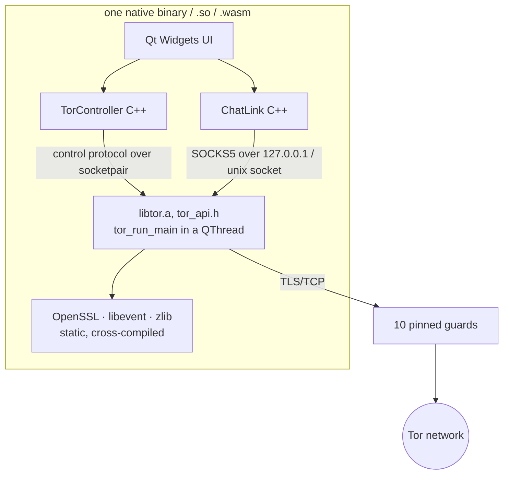
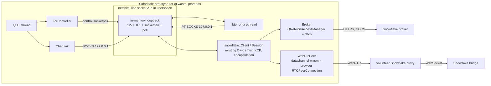

# prototype-tor-qt — embedded Tor node (Android + WebAssembly) — Plan

## Goal
A single Qt Widgets app (`ai-trash/prototypes/prototype-tor-qt`) that **contains
its own Tor node**, so it runs on a stock Android phone and in a browser with
nothing else installed. Same UI as the first cut: *Generate onion address*,
address display, send box, receive box, status/debug box. Tor uses the first 10
guards of `maycon/tor-nodes-list/guard-nodes.json` as entry guards.

Targets: **Android arm64-v8a APK** and **WebAssembly/PWA** (plus Linux desktop
for development, because it is the fastest edit-run loop).

## What changes vs. the first cut
The first cut spawned the system `tor` binary with `QProcess`. That is gone.
`chatlink.*`, the UI and the message format (u32 LE length + UTF-8, port 9999,
interoperable with prototype-arti) stay the same. `TorController` changes from
"spawn and connect over TCP" to "start tor in-process and talk to it over a
socketpair".

## Recommended approach: compile C tor into the app
Tor is written in C. Writing a Tor client **plus onion-service host** from
scratch in C++ means building the link protocol (TLS), ntor/ntor-v3
handshakes, consensus/microdescriptor parsing, circuit building, v3 descriptor
publication (ed25519 key blinding, HSDir hash ring), and intro/rendezvous
handling. That is tens of thousands of lines, and it is security-critical code.
Embedding the official tor works the way Orbot / `tor-android` already do on
Android:

- `tor_main_configuration_new()` + `tor_main_configuration_setup_control_socket()`
  gives an owning control connection without a TCP control port.
  `tor_run_main()` runs on its own thread.
- Dependencies (tor, OpenSSL 3, libevent 2.1, zlib) are fetched as git
  submodules / tarballs and built per target by one `build.sh`, using CMake
  `ExternalProject` (autotools under the hood), matching `prototype-minimal-qt`.
- Toolchains already in the container: Qt 6.8.3 `gcc_64`,
  `android_arm64_v8a`, `wasm_singlethread`, NDK 26.1, emsdk 3.1.56.

### Android — straightforward
Proven path. Tor's DataDirectory goes in the app's private files dir. Only the
`INTERNET` permission is needed. Expected APK growth: about 5–8 MB.

### WebAssembly — the hard part
**A browser cannot open raw TCP or TLS connections**, so wasm code cannot reach
a guard relay directly. Every Tor-in-the-browser project goes through a
WebSocket hop. Options:

| | How the first hop works | Uses the 10 guards? | Needs a server we run? |
|---|---|---|---|
| **A. WebSocket→TCP proxy** | Emscripten `-sPROXY_POSIX_SOCKETS` / websockify; the proxy forwards TCP to the guard IP. TLS stays end-to-end to the guard, so the proxy sees only which guard you use. | yes | **yes**, a small proxy (could run on the PGO server or locally for dev) |
| **B. WebTunnel / Snowflake bridges** | Tor pluggable transports reachable from a browser (WebSocket / WebRTC) | no, the bridge replaces the guard | no, but it depends on Tor Project bridge infrastructure and needs a PT client compiled to wasm (Snowflake/WebTunnel clients are Go) |

Additional wasm issues:
- Tor uses worker threads, which needs a **multithreaded Qt for wasm**. The
  container only has `wasm_singlethread`, so `wasm_multithread` must be added
  to the Dockerfile. The page must also be served with COOP/COEP headers for
  SharedArrayBuffer.
- An onion service in a browser tab is reachable only while the tab is open.
- Tor state (consensus cache, keys) goes in IDBFS, otherwise every load
  re-downloads the consensus (~2–3 MB microdescs).
- Realistic expectation: wasm is a **spike with real risk** (tor + OpenSSL +
  libevent under Emscripten has been done in experiments, but nothing is
  maintained upstream).

## Phases
1. **Linux desktop, embedded tor**: replace QProcess with in-process
   `libtor`. This proves the API, socketpair control, ADD_ONION, and the 10
   guards.
2. **Android APK**: cross-build deps with the NDK, package, and run on a phone.
3. **WebAssembly spike**: multithread Qt wasm, Emscripten deps build, plus the
   chosen first-hop option. Phase 3 stops at the first hard blocker and reports
   back.

Deliverables in `dist/` like prototype-minimal-qt (Linux binary, APK, PWA).

## Decisions (confirmed with user, 2026-10-12)
- Tor implementation: **embed the official C tor** (no external binary).
- WebAssembly first hop: **option A, our own WebSocket→TCP proxy** (keeps the 10 guards).
- Censorship-resistant path: **Snowflake implemented in C++** (libdatachannel
  + vendored KCP + own smux/encapsulation/broker code), so the same client can
  later serve Android and the browser (`datachannel-wasm`).
- Build system: **qmake `.pro`** with native Linux and Android targets; native
  deps from `deps/build-deps.sh` (sha256-pinned tarballs + a libdatachannel git tag).

## Status (2026-10-12)
- Phase 1 (Linux, embedded tor) and the Snowflake client: done and verified
  against the live network (direct and Snowflake, onion service reachable).
- Phase 2 (Android): APK builds; not yet run on a phone.
- Phase 3 (WebAssembly on iOS): 3a, 3b, 3c and 3d done (2026-10-17); 3e
  (iPhone Safari) open. See "Status (2026-10-17)" under Phase 3.

## Open questions
1. ~~OK to add Qt `wasm_multithread` to the Qt Dockerfile?~~ Yes (2026-10-17).
2. ~~Deps: submodules or tarballs?~~ Went with sha256-pinned tarballs
   downloaded by `deps/build-deps.sh` (keeps the repo small); revisit if
   offline builds matter.

## Phase 3: WebAssembly on iOS (planned 2026-10-17)

### Requirement (Cedric, 2026-10-17)
Everything runs **self-contained on an iPhone**: a web page with WebAssembly
in Safari. **We run no server**, so there is no WebSocket→TCP proxy. This
replaces the earlier decision to use our own WebSocket→TCP proxy (option A,
2026-10-12) for the browser.

Kept from 2026-10-17: multithreaded Qt for wasm (`wasm_multithread`, added
to the image), and the container toolchain as the reference (Qt 6.8.3 + emsdk
3.1.56).

### Consequences
- **A browser cannot open TCP**, so the 10 pinned guards cannot be used in
  the browser. A **Snowflake bridge takes the guard's place**, and Snowflake
  is the *only* mode in the wasm build. Direct mode stays on Linux and Android.
- What a page *can* reach, checked from the container on 2026-10-17:
  - Broker `https://snowflake-broker.torproject.net/client` and
    `https://1098762253.rsc.cdn77.org/client` answer with
    `Access-Control-Allow-Origin: *`, so `fetch()` from a page works.
    **Domain fronting is impossible** in a browser (it can't set a different `Host`),
    so the broker URL is used directly.
  - Bridge `wss://snowflake.torproject.net/` answers `101 Switching
    Protocols` to a foreign `Origin`, so a direct WebSocket would also work (see
    question 1).
  - WebRTC data channels: Safari supports `RTCPeerConnection`.
- **iOS keeps the tab alive only in the foreground.** When the screen locks or
  the user switches apps, Safari suspends the page within seconds. Circuits
  drop and the onion service becomes unreachable. This holds for a home-screen
  PWA as well. Nothing in this design can avoid it.
- **Cross-origin isolation** (needed for SharedArrayBuffer, i.e. threads):
  the page needs `COOP: same-origin` + `COEP: require-corp`. Static hosts that
  cannot set headers can use a service worker that adds them (the
  `coi-serviceworker` approach). Under COEP, CORS fetches to the broker still
  work.
- **Memory**: iOS Safari kills tabs that use too much memory. Qt + tor +
  OpenSSL must fit in a fixed shared-memory maximum. The aim is ≤ 256 MB, and
  it has to be measured on a phone.
- **Storage**: tor state goes in IndexedDB (IDBFS). Safari may evict it after
  about 7 days without a visit; then the consensus is re-downloaded.
- The page itself still has to be **served once over HTTPS** from somewhere
  (a static host is enough). Tor Project's broker, bridges and volunteer
  proxies are external dependencies, as with Tor Browser's Snowflake.

### Architecture

1. **`src/wasm/netshim.c`** (wasm only). It overrides `socket`, `socketpair`,
   `bind`, `listen`, `accept`, `connect`, `send`/`recv`,
   `read`/`write`/`close` on shim fds, `fcntl`, `get/setsockopt`,
   `getsockname`, `poll` and `select`. **Only loopback is supported**:
   every socket is an in-memory byte pipe with a mutex/condvar, safe across
   threads. Connecting to a non-loopback address returns `ENETUNREACH`, so tor can
   only leave the tab through the Snowflake PT. Shim fds use a high number
   range; other fds go to Emscripten unchanged.
2. **Build-time changes for tor and libevent**: libevent uses only the `poll` backend.
   tor is configured without eventfd/pipe2, so its alert sockets use
   `socketpair()` and land in the shim.
3. **Snowflake in the browser**: `WebRtcPeer` builds against
   **datachannel-wasm**, the same `rtc::` API backed by the browser's
   `RTCPeerConnection`, so the Snowflake code stays shared with Linux/Android.
   `Broker` drops `fronts=` on wasm. On wasm, `QNetworkAccessManager` uses
   `fetch()`, with a `Content-Type` that needs no preflight.
4. **Qt sockets**: Qt for wasm has no `QLocalSocket`/`QTcpServer`, and its
   notifiers don't see shim fds. Behind `wasm { }`, a small
   `ShimSocket` (QIODevice) / `ShimServer` is used by `TorController`,
   `ChatLink` and `snowflake::Client`. A shim wake-up is posted to the Qt
   thread.
5. **`deps/build-deps.sh wasm`**: zlib, OpenSSL (`no-asm`, threads), libevent
   and tor built with `emconfigure`/`emmake -pthread`, plus datachannel-wasm
   (CMake, Emscripten toolchain).
6. **`.pro` `wasm` branch**: `-pthread`, a fixed `-sMAXIMUM_MEMORY`,
   `-lidbfs.js`, netshim + shim Qt classes, Snowflake-only UI. The Direct
   option is greyed out.
7. **`web/`**: the page, plus the COOP/COEP service worker and a
   manifest so it can be added to the home screen.

### Phases
| | Step | Verifiable here? |
|---|---|---|
| 3a | `build-deps.sh wasm` (tor, OpenSSL, libevent, zlib, datachannel-wasm) | yes |
| 3b | **Spike**: netshim + headless tor-only wasm test (`emcc`, no Qt) with the Snowflake client, bootstrapping to 100 % in headless Chromium | yes (Chromium, not Safari) |
| 3c | Qt shim classes + `.pro` wasm branch; app links and runs | **no**: needs `wasm_multithread` in the image |
| 3d | End to end in desktop Chromium: onion address, chat with the Linux build | after 3c |
| 3e | iPhone Safari: bootstrap, memory, chat with the screen on | **only you**, on a phone |

Phase 3b is the risk spike: it stops at the first hard blocker and reports back.

### Status (2026-10-17)
- **3c done.** `src/loopback.h` picks the socket types: Qt's natively,
  `ShimSocket`/`ShimServer` (`src/wasm/shimsocket.*`) in the browser,
  including SOCKS5 for onion dials, so `ChatLink`, `TorController` and
  `snowflake::Client` are shared. Snowflake transports share a `Peer` base:
  `WebRtcPeer` and the browser-only `WebSocketPeer`. `web/` has the page
  (IndexedDB at `/persist` in `preRun`, URL query → env), the COOP/COEP
  service worker and the manifest. The `.pro` `wasm` branch links against
  `wasm_multithread`. The release `.wasm` is 19 MB.
- **3d done** in headless Chromium against the live network, with a plain
  static server (the service worker supplied COOP/COEP):
  WebRTC proxies → bootstrap 100 % → onion published; Linux → browser and
  browser → Linux chat; consensus reused from IndexedDB after a reload;
  WebSocket fallback (UDP blocked, empty profile) → bootstrap 100 %.
- Native Linux (direct + Snowflake) still works after the refactor; the Android
  APK still builds.
- Found: when the broker has no proxy, CDN77 answers 504 **without CORS
  headers**, so the page only sees status 0. It is handled as a failed attempt.
- `build.sh` builds all three targets into `dist/` (Linux binary, debug APK,
  `dist/web/`), running `deps/build-deps.sh` first where needed.
- **3e** is yours: open `index.html` from an HTTPS host on the iPhone, then
  check bootstrap, memory (256 MB cap) and chat.

### Decisions (Cedric, 2026-10-17)
- Snowflake path: **both, WebRTC first**. The broker-assigned volunteer proxy
  over WebRTC is tried first. After a timeout, a direct WebSocket to
  `wss://snowflake.torproject.net/` is used. Both carry the same
  encapsulation/KCP/smux stream, so only the transport underneath `Session`
  differs.
- Hosting is undecided, so cross-origin isolation comes from a **service
  worker** that adds COOP/COEP (works on any static HTTPS host).

### Open questions
1. ~~Where is the image's Qt Dockerfile?~~ `tmp/Dockerfile.qt` (2026-10-17), updated
   to Qt 6.8.3 / emsdk 3.1.56 / `/opt/Qt` to match the running container, plus
   `wasm_multithread` (`$QT_WASM_MT_DIR`). 3c waits for the rebuilt image.
