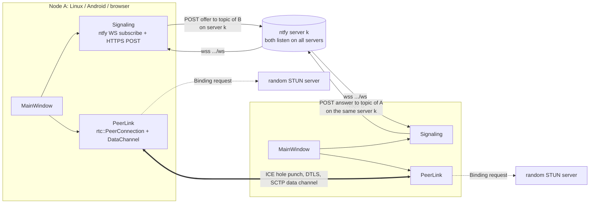
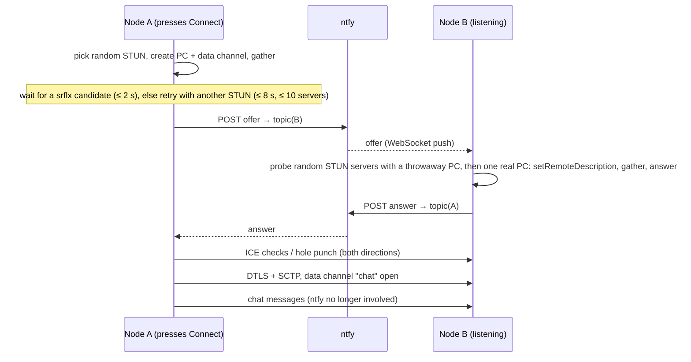

# prototype-webrtc-stun — direct WebRTC chat by node name — Plan

## Goal
A Qt Widgets app (`ai-trash/prototypes/prototype-webrtc-stun`) where two nodes
chat over a **direct WebRTC data channel**. NAT traversal uses **STUN only**,
with no TURN. Each connection attempt picks a random server from
[mondain's STUN list](https://gist.github.com/mondain/b0ec1cf5f60ae726202e).
Signaling (offer/answer exchange) goes through **public ntfy servers**, with
the node name as the mailbox address.

Targets, built like `prototype-tor-qt` (qmake `.pro`, `build.sh`, `dist/`):
**native Linux**, **Android arm64-v8a APK**, **WebAssembly** (static page).

## UI
One window, top to bottom:

| Widget | Behaviour |
|---|---|
| **Node name** (read-only) + **Generate** button | Generates a fresh random name, saves it (QSettings), and re-subscribes to its ntfy topic. The name is generated automatically on first start, so the node is reachable immediately. |
| **Other node** (line edit) | Name of the peer to connect to. |
| **Connect** button | Starts an offer to the other node (see sequence below). Becomes **Disconnect** while connected. |
| **Send** line edit + Send button (Enter sends) | Sends UTF-8 text over the data channel. Disabled until the channel is open. |
| **Received** (read-only) | `hh:mm:ss <peer>: text`, plus your own sent lines marked `me:`. |
| **Status** (read-only, like prototype-tor-qt) | Timestamped steps with ms since Connect: ntfy subscribed, STUN server chosen, candidates (`2 host, 1 srflx`), offer sent, answer received, ICE state, DTLS/channel open. Gives you the real connect times. |

## Architecture



### Classes (`src/`)
- **`NodeName`**: generates and validates names, and maps a name to an ntfy
  server and topic.
- **`Signaling`**: holds the ordered ntfy server list (resource
  `ntfy-servers.txt`) and **listens on all of them**. For each server it keeps
  a streaming subscription to its own topic and reconnects each one
  independently with backoff:
  - natively: `QNetworkAccessManager` `GET https://<server>/<topic>/json`, a
    JSON line per event (Qt's TLS uses the system CA store, also on Android);
  - in the browser: `wss://<server>/<topic>/ws` through datachannel-wasm's
    `rtc::WebSocket` (the browser's WebSocket). Same JSON events.
 Publishes with `QNetworkAccessManager` `POST
  https://<server>/<topic>` (CORS works on all listed servers, checked
  2026-10-18). Emits `offerReceived(server, from, sid, sdp)` and
  `answerReceived(server, from, sid, sdp)`.
- **ntfy server rotation**: the first Connect attempt posts the offer to the
  **first** server in the list. If that attempt fails, the next attempt uses
  the **next** server, then the one after, and so on, wrapping around at the
  end of the list. An attempt counts as failed when:
  - the POST fails (network error or HTTP status ≠ 200, e.g. 429);
  - no answer arrives within 15 s;
  - the data channel does not open within 15 s after the answer.

  Failed attempts are retried automatically, once per server (one full
  round). The next Connect press continues the rotation where it stopped.
  The answering node replies **on the server the offer arrived on**, which
  the caller is guaranteed to be listening on. The status pane logs which
  server each attempt used. Initial list, in order (all reachable and
  CORS-enabled on 2026-10-18): ntfy.sh, ntfy.adminforge.de, ntfy.envs.net,
  ntfy.tedomum.fr, ntfy.mzte.de, ntfy.hostux.net, notify.utilibre.org,
  ntfy.fossman.de.
- **`StunPicker`**: holds the gist list (resource `stun-servers.txt`, verbatim
  copy of the gist) and picks a random entry per attempt, skipping entries
  that already failed in this session.
- **`PeerLink`**: one `rtc::PeerConnection` with one ordered, reliable data
  channel `chat`. Reuses the patterns of
  `prototype-tor-qt/src/snowflake/webrtcpeer.*`: callbacks are reposted to
  the Qt thread, with Linux/Android and wasm teardown variants.
- **`MainWindow`**: UI and orchestration.

### Signaling messages (ntfy message body, JSON, < 4 KB so ntfy.sh never turns it into an attachment)
```json
{"v":1,"type":"offer","from":"<name>","sid":"<random 8 hex>","sdp":"<full SDP>"}
{"v":1,"type":"answer","from":"<name>","sid":"<same sid>","sdp":"<full SDP>"}
{"v":1,"type":"bye","from":"<name>","sid":"<sid>"}
```
- Full SDP with all candidates (non-trickle): one message per direction.
  Host candidates are **kept**, so two nodes on the same LAN connect directly
  without STUN.
- `sid` ties an answer to its offer. Stale answers or ones from other nodes
  are dropped and logged.
- **Glare** (both press Connect at the same moment): the node with the
  lexically smaller name keeps its offer, and the other drops its own and
  answers.
- Subscriptions don't ask for old messages (no `since=`), so a re-subscribe
  doesn't replay old offers.

### Connect sequence


**Dead STUN servers**: about half of the gist list does not answer (measured
2026-10-18: 19 of 40). The offer/answer is sent as soon as a **srflx**
candidate shows up, plus a 300 ms grace period for the remaining candidates.
If none shows up, the peer connection is recreated with another random
server. Silent servers take the full **2 s**; names that no longer resolve
fail within milliseconds. This continues for up to **8 s and 10 servers**
(well inside the 15 s answer timeout). Failed servers are skipped for the
session. After that it sends host-only candidates, which work on a LAN, and
logs a warning.

**The answering side must not recreate its peer connection** (found in
testing, 2026-10-18): a connection that has the offer starts ICE checks at
once, and the caller's ICE locked onto a discarded one, so DTLS failed. The
answerer therefore **probes** STUN servers with a throwaway connection that
never sees the offer, using the same retry rules. Then it creates exactly one
real connection with the server that worked and always sends its answer.
Chrome also ends gathering as soon as ICE connects on a LAN pair, so a
browser answer on a LAN may legitimately carry no srflx candidate.

## Build
- **Dependencies, `deps/build-deps.sh linux|android|wasm`**, a trimmed copy of
  prototype-tor-qt's script, with no tor, libevent or zlib:
  - Linux/Android: OpenSSL 3 + libdatachannel v0.24.6 (libjuice, usrsctp),
    without WebSocket (`NO_WEBSOCKET=ON`; Qt does the HTTPS). OpenSSL is shared on Android, as in prototype-tor-qt,
    because Qt's TLS backend for the ntfy POST loads the same `libssl_3.so`.
  - wasm: datachannel-wasm v0.4.0 only (the browser does TLS, WebRTC and
    WebSocket).
- **Qt for WebAssembly single-threaded** (`wasm_singlethread`). Nothing here
  needs threads, so the page needs no COOP/COEP headers and no service
  worker, and it runs from any static HTTPS host. datachannel-wasm is built
  without `-pthread` to match.
- **`build.sh [linux] [android] [wasm] [--clean]`**: same structure and
  `dist/` layout as prototype-tor-qt. Build trees go to
  `/shared/tmp/prototype-webrtc-stun-build`.
  - `dist/prototype-webrtc-stun`
  - `dist/prototype-webrtc-stun-debug.apk`
  - `dist/web/`
- Android: only the `INTERNET` permission; min SDK 28, target 34.

## Verification
| | Check | Where |
|---|---|---|
| 1 | All three targets build via `build.sh` | container |
| 2 | Linux ↔ Linux, two instances: names, ntfy exchange, srflx gathered, channel open, chat both ways; timing log | container |
| 3 | Linux ↔ browser (wasm in headless Chromium, as in prototype-tor-qt 3d) | container |
| 4 | Dead-STUN retry: dead entries show up by chance; `WEBRTC_STUN_FIRST` forces one | container |
| 5 | Android phone ↔ Linux/browser, Wi-Fi and mobile data | **you** (expect failures on symmetric-NAT carriers: no TURN by design) |

## Not in scope
TURN, encryption or authentication of the signaling messages (topic names
are public; anyone who knows a node name can send it offers), ICE restart on
network change, more than one peer at a time, message history.

## Status (2026-10-18)
Implemented in `ai-trash/prototypes/prototype-webrtc-stun` (see its README).
`build.sh` builds all three targets.

Verified in the container against live ntfy/STUN servers:
- Linux ↔ Linux, Linux → browser and browser → Linux (headless Chromium):
  connected, chat both ways, 0.5–7 s depending on dead STUN picks.
- ntfy server rotation on an unanswered call.
- STUN retry on dead servers.

Real NATs (2026-10-18, Linux at home ↔ Android on mobile data): connects
srflx ↔ srflx, but only when the home side sends first; the phone's early
packet kills the flow at the home router (confirmed by flipping the order).
Fix: who sends first alternates per attempt (offer flag `hold`), and the
caller fails an attempt 8 s after the answer instead of 15 s. A "WebRTC
debug log" checkbox shows libjuice's ICE events.

Still open:
- **Alternating build between the two real networks** (yours).
- In 1 of 11 Linux → browser runs, the browser's automatic first message
  did not arrive; not reproduced in 5 repeats.

## Decisions / open questions
1. ~~Which ntfy server(s)?~~ Listen on all servers in the list; post to the
   first, and move to the next server on each failed attempt (Cedric,
   2026-10-18).
2. ~~Node name format~~ Words, `brave-otter-417` (Cedric, 2026-10-18).
3. ~~Incoming offers~~ Auto-accept from anyone and fill in "Other node"
   (Cedric, 2026-10-18).
4. ~~Where to work~~ Main tree, `ai-trash/prototypes/prototype-webrtc-stun`,
   uncommitted (Cedric, 2026-10-18).
